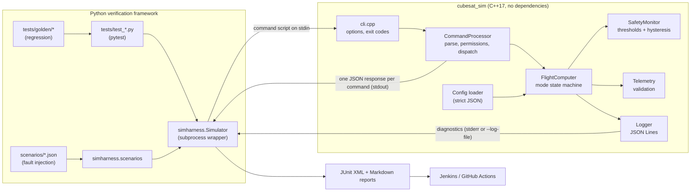
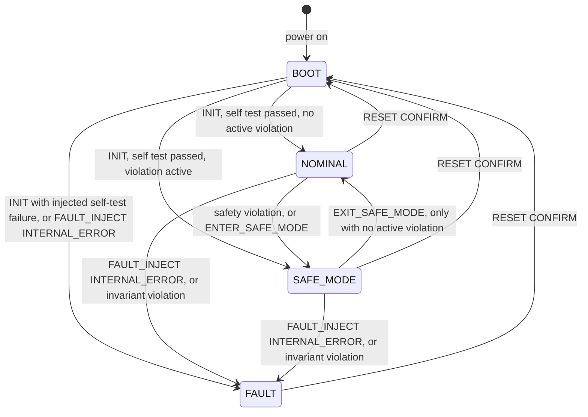

# CubeSat Avionics Test Automation Simulator

A software-in-the-loop CubeSat flight-computer simulator with C++ control
logic, Python-based automated verification, fault injection, diagnostic
reporting, and Jenkins CI.

> **This is an educational simulation, not flight software.** It has never
> flown, has not been tested in space, is not certified or qualified for
> flight, and has not been validated against any real spacecraft hardware.
> All telemetry is simulated and every threshold is an invented demonstration
> value. See [docs/limitations.md](docs/limitations.md).

---

## Contents

1. [Problem statement](#problem-statement)
2. [Why test embedded / avionics-like software this way](#why-test-embedded--avionics-like-software-this-way)
3. [What the simulator does](#what-the-simulator-does)
4. [Architecture](#architecture)
5. [Operating-mode state machine](#operating-mode-state-machine)
6. [Technology stack](#technology-stack)
7. [Repository structure](#repository-structure)
8. [Installation (macOS)](#installation-macos)
9. [Installation (Linux / Ubuntu)](#installation-linux--ubuntu)
10. [Build](#build)
11. [Running the simulator](#running-the-simulator)
12. [Running tests](#running-tests)
13. [Fault-injection examples](#fault-injection-examples)
14. [Expected command output](#expected-command-output)
15. [Test reports](#test-reports)
16. [Jenkins](#jenkins)
17. [GitHub Actions](#github-actions)
18. [Verified results](#verified-results)
19. [Design decisions](#design-decisions)
20. [Known limitations](#known-limitations)
21. [Troubleshooting](#troubleshooting)
22. [Future improvements](#future-improvements)

---

## Problem statement

Flight software must react correctly to conditions that are hard, slow or
risky to create on real hardware: a battery sagging below a limit, a sensor
reporting garbage, the ground link disappearing, a corrupt command. Each
behaviour has to be specified precisely (which mode, which error, which log
event) and re-verified automatically every time the code changes.

This project builds a small but complete version of that workflow on a
laptop, with no hardware: a simulated flight computer written in C++, and a
Python verification framework that drives the real compiled program, injects
faults, checks every response against a specification, and publishes
traceable results in CI.

## Why test embedded / avionics-like software this way

* **Failures are expensive and often unrecoverable** once software is
  deployed, so behaviour is verified exhaustively beforehand.
* **Off-nominal behaviour matters most.** The interesting bugs live at
  boundaries (is 6.8 V "low"?), in illegal state transitions, and in how
  corrupt input is handled. The tests concentrate there.
* **Software-in-the-loop (SIL)** runs the real control logic against
  simulated inputs. It is fast and cheap, and it catches logic defects long
  before hardware-in-the-loop (HIL) or environmental testing. It does
  **not** replace them.
* **Determinism and traceability.** A simulated clock and deterministic logs
  make every failure reproducible, and every test is linked to a requirement.

## What the simulator does

* Models a flight computer with four modes: **BOOT, NOMINAL, SAFE_MODE,
  FAULT**. All transitions go through one transition table.
* Accepts simulated telemetry: battery voltage (V), temperature (°C),
  attitude error (degrees), comm link status, sensor validity, sequence number.
* Validates every input: strict number parsing, plausibility ranges, required
  fields, monotonic sequence numbers, line length and byte checks.
* Evaluates seven configurable safety rules with strict trip limits and
  hysteresis: low battery, over- and under-temperature, attitude, invalid
  sensors, stale telemetry, communication timeout.
* Enters SAFE_MODE on a violation, forces the simulated payload off, and only
  returns to NOMINAL on a ground command when every violation has cleared.
* Never treats a communication loss as an internal FAULT. FAULT is reserved
  for simulated software errors and can only be left with `RESET CONFIRM`.
* Answers every command with one JSON object on stdout. It writes structured
  JSON-Lines diagnostics (sequence number, simulated time, severity,
  component, event, mode, message) to stderr or a log file.

## Architecture



The tests never re-implement flight logic in Python. They start the compiled
binary with `subprocess` (argument lists, never a shell) and send a whole
command script to **one process**, so multi-step behaviour is tested on real
persistent state. Details: [docs/architecture.md](docs/architecture.md).

## Operating-mode state machine



| Command | BOOT | NOMINAL | SAFE_MODE | FAULT |
|---------|:----:|:-------:|:---------:|:-----:|
| `HELP`, `STATUS`, `GET_TELEMETRY`, `TICK <s>` | yes | yes | yes | yes |
| `TELEMETRY <fields>` | yes | yes | yes | no |
| `INIT` | yes | no | no | no |
| `ENTER_SAFE_MODE` | no | yes | yes (no-op) | no |
| `EXIT_SAFE_MODE` | no | no | yes | no |
| `PAYLOAD <ON\|OFF>` | no | yes | no | no |
| `RESET CONFIRM` | no | yes | yes | yes |
| `FAULT_INJECT <INTERNAL_ERROR\|SELF_TEST_FAILURE>` | yes | yes | yes | no |

Safety rules (demo thresholds from `config/simulation_config.json`; trip
comparisons are strict, so a value exactly at the limit is acceptable):

| Rule | Trips | Clears (hysteresis) |
|------|-------|---------------------|
| `BATTERY_LOW` | `battery_v < 6.8` | `>= 7.0` |
| `TEMPERATURE_HIGH` / `TEMPERATURE_LOW` | `temp_c > 60` / `< -20` | `<= 55` / `>= -15` |
| `ATTITUDE_EXCEEDED` | `attitude_deg > 15` | `<= 10` |
| `SENSOR_INVALID` | `sensors=INVALID` | next valid frame |
| `TELEMETRY_STALE` | no frame for more than 10 s | fresh frame |
| `COMM_TIMEOUT` | no `comm=UP` for more than 60 s | `comm=UP` frame |

The full specification, including the response to every event, is in
[docs/state-machine.md](docs/state-machine.md).

## Technology stack

| Area | Technology |
|------|------------|
| Simulator | C++17, standard library only (in-house strict JSON parser) |
| Build | CMake (>= 3.16), GCC or Clang/Apple Clang, `-Wall -Wextra -Wpedantic -Wshadow -Wconversion ...` |
| C++ unit tests | Built-in minimal runner, registered with CTest, JUnit output |
| Verification | Python 3.9+, pytest, `subprocess` |
| Reports | JUnit XML, Markdown (fault injection, traceability) |
| Scripts | Bash (`set -euo pipefail`, ShellCheck-clean) |
| CI | Jenkins declarative pipeline; GitHub Actions (Linux + macOS + sanitizers) |
| Optional | Docker (`ci/Dockerfile`) as a reproducible Linux agent |

No paid services, cloud accounts, web servers or hardware are needed.

## Repository structure

```text
cubesat-avionics-test-automation/
├── CMakeLists.txt              # library, CLI, unit tests, warning/sanitizer/seeded-defect options
├── Jenkinsfile                 # declarative CI pipeline
├── LICENSE
├── README.md
├── pytest.ini                  # markers, JUnit settings
├── requirements.txt            # pytest
├── .github/workflows/ci.yml    # GitHub Actions (same scripts as Jenkins)
├── ci/Dockerfile               # optional reproducible Linux build/test image
├── config/
│   └── simulation_config.json  # demonstration thresholds and timing
├── docs/
│   ├── architecture.md         # components, data flow, design decisions
│   ├── state-machine.md        # the specification: modes, transitions, commands, rules
│   ├── test-plan.md            # strategy, techniques, entry/exit criteria, report workflow
│   ├── test-matrix.md          # requirement -> test traceability (verified-run snapshot)
│   ├── fault-injection.md      # framework and scenario catalogue
│   ├── fault-injection-report.md # expected vs actual (verified-run snapshot)
│   ├── jenkins.md              # Jenkins setup, controller vs agent
│   ├── demo-guide.md           # demonstration scenarios
│   ├── troubleshooting.md
│   └── limitations.md
├── include/cubesat/            # public headers
│   ├── cli.hpp  command_processor.hpp  config.hpp  flight_computer.hpp
│   ├── json.hpp  logger.hpp  modes.hpp  result.hpp  safety_monitor.hpp  telemetry.hpp
├── src/                        # implementation (cubesat_core library + main.cpp)
│   ├── cli.cpp  command_processor.cpp  config.cpp  flight_computer.cpp
│   ├── json.cpp  logger.cpp  main.cpp  safety_monitor.cpp  telemetry.cpp
├── unit_tests/unit_tests.cpp   # 21 C++ unit tests
├── simharness/                 # Python harness: build/locate binary, run it, scenarios, requirements
├── scenarios/                  # FI-01..FI-19 fault-injection scenarios (+ negative_control/)
├── tests/
│   ├── conftest.py             # fixtures, requirement-ID validation, JUnit properties
│   ├── requirements.json       # 42 demonstration requirements
│   ├── test_startup.py  test_commands.py  test_operating_modes.py  test_telemetry.py
│   ├── test_safety_rules.py  test_fault_injection.py  test_recovery.py
│   ├── test_regression.py  test_cli_contract.py  test_selfcheck.py
│   ├── golden/                 # golden regression scripts and recorded outputs
│   └── selfcheck/              # deliberately failing check (never collected normally)
├── tools/
│   ├── run_scenarios.py        # fault-injection report
│   ├── traceability_report.py  # requirement matrix from JUnit XML
│   ├── format_session.py       # readable session table
│   └── update_golden.py        # regenerate golden files (review the diff!)
├── scripts/
│   ├── setup_macos.sh  setup_linux.sh   # check tools; optional project-local .venv
│   ├── build.sh  run_tests.sh  run_demo.sh  clean.sh
│   ├── verify_defect_detection.sh       # seeded-defect (mutation) check
│   └── lib.sh                           # shared helpers
└── reports/                    # generated reports (git-ignored except .gitkeep)
```

## Installation (macOS)

```bash
xcode-select --install          # Apple Clang + git (skip if already installed)
brew install cmake python       # or install CMake/Python from their websites
git clone https://github.com/navyasingh24/cubesat-avionics-test-automation.git
cd cubesat-avionics-test-automation
scripts/setup_macos.sh --create-venv
```

`setup_macos.sh` **only checks** your tools and prints install hints. It
never uses `sudo` or installs system packages. `--create-venv` creates
`./.venv` inside this project and installs pytest there. All project scripts
use `.venv` automatically when it exists.

## Installation (Linux / Ubuntu)

```bash
sudo apt-get update && sudo apt-get install -y build-essential cmake python3 python3-venv git
git clone https://github.com/navyasingh24/cubesat-avionics-test-automation.git
cd cubesat-avionics-test-automation
scripts/setup_linux.sh --create-venv
```

## Build

```bash
scripts/build.sh                   # configure + compile into build/
scripts/build.sh --clean           # fresh build directory
CUBESAT_WERROR=ON scripts/build.sh # warnings are errors (what CI uses)
CUBESAT_SANITIZERS=ON scripts/build.sh   # AddressSanitizer + UBSan (GCC/Clang)
```

Or with plain CMake:

```bash
cmake -S . -B build
cmake --build build
```

Outputs: `build/cubesat_sim` (simulator) and `build/cubesat_unit_tests`.

## Running the simulator

```bash
./build/cubesat_sim --help
./build/cubesat_sim --validate-config config/simulation_config.json

# Interactive: type commands, one per line; Ctrl-D ends the session.
./build/cubesat_sim --config config/simulation_config.json

# Scripted, with logs in a file and a readable table:
./build/cubesat_sim --config config/simulation_config.json \
    --script tests/golden/mission_day.script --log-file mission.log.jsonl \
    | python3 tools/format_session.py

# The full demonstration (build, mission table, scenarios, failure detection):
scripts/run_demo.sh
```

Exit codes: `0` ok, `2` usage error, `3` configuration error, `4`
script/log file error, `5` internal error. A rejected command is reported in
its JSON response and does not end the session.

## Running tests

```bash
scripts/run_tests.sh                       # everything; exits non-zero if anything fails
scripts/run_tests.sh unit                  # C++ unit tests
scripts/run_tests.sh system                # pytest system tests
scripts/run_tests.sh fault                 # fault-injection tests + scenario report
scripts/run_tests.sh regression            # golden-output + determinism tests
scripts/run_tests.sh report                # requirement traceability matrix
scripts/verify_defect_detection.sh         # prove a seeded bug is caught
```

Individual tests with pytest (activate the venv first, or prefix commands
with `.venv/bin/`):

```bash
source .venv/bin/activate
pytest                                         # whole suite (builds the binary if needed)
pytest tests/test_safety_rules.py -v           # one file
pytest -k battery_boundary -v                  # by name
pytest "tests/test_safety_rules.py::test_battery_boundary[6.8-NOMINAL]"   # one case
pytest -m fault_injection                      # markers: boundary, negative, fault_injection, regression
pytest --junitxml=reports/junit.xml            # JUnit XML for any selection
```

`pytest` builds `build/cubesat_sim` with CMake at the start of a session
(incremental, so it always tests the current source) unless `CUBESAT_SIM_BIN`
points at a specific binary.

## Fault-injection examples

```bash
python3 tools/run_scenarios.py     # runs scenarios/*.json -> reports/fault_injection_report.md
```

| ID | Fault | Expected |
|----|-------|----------|
| FI-01 | battery 6.79 V (limit 6.8) while the payload is on | SAFE_MODE, `BATTERY_LOW`, payload forced OFF |
| FI-03 | implausible 25 V frame, then `sensors=INVALID` with garbage value | first rejected `OUT_OF_RANGE`; then only `SENSOR_INVALID` (garbage not trusted) |
| FI-05 | link DOWN 20 s vs 21 s (timeout 20 s) | warning only, then SAFE_MODE `COMM_TIMEOUT`; never FAULT |
| FI-09 | recovery at 6.5 V, 6.9 V, 7.0 V | refused, refused (hysteresis), accepted |
| FI-13 | 6 attempts to leave FAULT without reset | all `NOT_PERMITTED_IN_MODE` |
| FI-15 | truncated JSON configuration | exit 3, `CONFIG_INVALID` |

All 19 scenarios are listed in [docs/fault-injection.md](docs/fault-injection.md).
Two deliberate controls prove that failures are detected:

```bash
# A scenario with a deliberately WRONG expectation must FAIL (exit code 1):
python3 tools/run_scenarios.py --scenario-dir scenarios/negative_control --report-name negative_control_report

# A deliberately BROKEN build (battery limit `<` changed to `<=`) must be caught:
scripts/verify_defect_detection.sh
```

## Expected command output

Actual output from this command (verified run):

```bash
printf '%s\n' \
  "TELEMETRY seq=1 battery_v=7.6 temp_c=22.5 attitude_deg=2.0 comm=UP sensors=VALID" \
  "INIT" \
  "TELEMETRY seq=2 battery_v=6.75 temp_c=22.5 attitude_deg=2.0 comm=UP sensors=VALID" \
  "EXIT_SAFE_MODE" \
  "FLY_TO_MOON" \
| ./build/cubesat_sim --config config/simulation_config.json 2>/dev/null
```

```json
{"response_seq":1,"command":"TELEMETRY","status":"OK","mode":"BOOT","sim_time_s":0,"data":{"accepted_seq":1,"active_violations":[]}}
{"response_seq":2,"command":"INIT","status":"OK","mode":"NOMINAL","sim_time_s":0,"data":{"self_test":"PASSED","active_violations":[]}}
{"response_seq":3,"command":"TELEMETRY","status":"OK","mode":"SAFE_MODE","sim_time_s":0,"data":{"accepted_seq":2,"active_violations":["BATTERY_LOW"]}}
{"response_seq":4,"command":"EXIT_SAFE_MODE","status":"REJECTED","mode":"SAFE_MODE","sim_time_s":0,"error":{"code":"ACTIVE_VIOLATIONS","message":"cannot exit SAFE_MODE while violations are active: [\"BATTERY_LOW\"]"}}
{"response_seq":5,"command":"FLY_TO_MOON","status":"REJECTED","mode":"SAFE_MODE","sim_time_s":0,"error":{"code":"UNKNOWN_COMMAND","message":"unknown command 'FLY_TO_MOON'; send HELP for the command list"}}
```

Matching diagnostic log entries from stderr (two of the fourteen, verbatim):

```json
{"log_seq":7,"sim_time_s":0,"severity":"WARNING","component":"SafetyMonitor","event":"SAFETY_VIOLATION","mode":"NOMINAL","message":"Safety rule BATTERY_LOW violated","details":{"rule":"BATTERY_LOW","detail":"battery_v=6.75 (trip < 6.8, clear >= 7)"}}
{"log_seq":8,"sim_time_s":0,"severity":"WARNING","component":"FlightComputer","event":"MODE_CHANGE","mode":"SAFE_MODE","message":"Mode changed NOMINAL -> SAFE_MODE","details":{"from":"NOMINAL","to":"SAFE_MODE","reason":"BATTERY_LOW"}}
```

## Test reports

After `scripts/run_tests.sh`, `reports/` contains:

| File | Content |
|------|---------|
| `unit-tests.xml` | C++ unit tests (JUnit, one entry per test) |
| `junit-system.xml`, `junit-fault-injection.xml`, `junit-regression.xml` | pytest results (JUnit; requirement IDs as properties) |
| `fault_injection_report.md` / `.json` | per-scenario initial state, input, expected, actual, PASS/FAIL, diagnostics |
| `traceability.md` | requirement → tests → result matrix |
| `seeded_defect_run.txt` | output of the defect-detection check (if run) |

Workflow for a failure: read the failing stage at the end of the console
output, open the pytest assertion (it prints the relevant JSON), reproduce
with the command list in a script file, check the log events, then fix the
code. See [docs/test-plan.md](docs/test-plan.md#7-sample-test-report-workflow).

## Jenkins

The [`Jenkinsfile`](Jenkinsfile) has these stages: Checkout → Environment &
tool checks → Configure (CMake) → Compile → Unit tests → System verification
→ Fault injection & regression → Defect-detection self-check → Traceability.
In `post`, it always publishes JUnit results and archives `reports/`.

* A compilation failure stops the pipeline.
* A test failure marks the stage and build **FAILURE**. Remaining suites
  still run, so every report is produced. Nothing is swallowed.
* No credentials, cloud services or hardware are needed.
* Required plugins: Pipeline, Git, JUnit. Required agent tools: bash, git,
  CMake, a C++17 compiler, Python 3.9+.

Step-by-step setup (including Jenkins in Docker on a Mac, native macOS, a
Docker-based Linux agent, and the controller-vs-agent explanation) is in
[docs/jenkins.md](docs/jenkins.md). Create a **new** job for this repository;
do not modify other projects' jobs or credentials.

## GitHub Actions

[`.github/workflows/ci.yml`](.github/workflows/ci.yml) runs on pushes to
`main`, on pull requests, and manually. It uses the same scripts as Jenkins
on `ubuntu-24.04` and `macos-14`, plus a separate AddressSanitizer/UBSan job,
and uploads `reports/` as an artifact. No secrets are needed.

## Verified results

Run on **2026-10-17** in a Linux container (Ubuntu 24.04.5, x86_64), GCC
13.3.0, Clang 18.1.3, CMake 3.28.3, Python 3.13.16 + pytest 9.1.1:

| Check | Result |
|-------|--------|
| Build with GCC and with Clang, `-Werror` and the full warning set | 0 warnings |
| C++ unit tests (also under AddressSanitizer + UBSan) | 21 passed, 0 failed |
| Full pytest suite against the AddressSanitizer + UBSan simulator build | 285 passed, 0 failed |
| pytest system tests | 260 passed, 0 failed, 0 skipped |
| pytest fault-injection tests | 19 passed, 0 failed, 0 skipped |
| pytest regression tests | 6 passed, 0 failed, 0 skipped |
| **Total automated tests** | **306 passed, 0 failed, 0 skipped** |
| Fault-injection scenario runner | 19/19 PASS |
| Requirement traceability | 42/42 requirements covered and passing |
| Negative-control scenario | correctly reported FAIL (exit 1) |
| Seeded defect (`<` → `<=`) | detected by `test_battery_boundary[6.8-NOMINAL]` |
| Jenkinsfile stage commands, run in order from a fresh clone | all passed |
| pytest suite on Python 3.11 | 285 passed |
| ShellCheck on all scripts | clean |

**Not yet verified:** a real Jenkins server run (the Jenkins download hosts
were not reachable from the development container), a native macOS run
(covered by the `macos-14` GitHub Actions job once it runs), and the GitHub
Actions workflow itself. Code coverage was not measured, so no coverage
percentage is claimed.

## Design decisions

* **Zero dependencies in C++.** An in-house strict JSON parser keeps the
  build offline and lets configuration validation reject duplicate keys and
  excessive nesting.
* **One process per scenario, simulated clock.** State persists across a
  command script. Timeouts are deterministic and tests run in milliseconds.
* **Single transition table** and an **invariant check after every command**:
  illegal transitions and inconsistent states are impossible to report as
  healthy.
* **Detection vs response separation:** `SafetyMonitor` reports rule changes,
  `FlightComputer` decides on mode changes.
* **Hysteresis and strict trip limits**, both pinned down by boundary tests.
* **Ground-commanded recovery:** clearing a violation is logged, but leaving
  SAFE_MODE is an explicit, verifiable command.
* **stdout for data, stderr for diagnostics:** responses are always parseable.
* **Same scripts everywhere:** local runs, Jenkins and GitHub Actions call
  `scripts/build.sh` and `scripts/run_tests.sh`.
* **Prove the tests can fail:** a negative-control scenario, a deliberately
  failing pytest file run in a subprocess, and a seeded-defect build.

More in [docs/architecture.md](docs/architecture.md#6-design-decisions).

## Known limitations

SIL only (no real-time behaviour, RTOS, drivers or electrical interfaces);
simplified independent threshold rules; text commands instead of a space
link protocol, with no command authentication; invented thresholds and
requirements; coverage not measured. Read
[docs/limitations.md](docs/limitations.md) before drawing conclusions from
the results.

## Troubleshooting

Common problems (missing CMake/compiler/pytest, stale build directory,
golden-file updates, Jenkins permissions) and fixes are in
[docs/troubleshooting.md](docs/troubleshooting.md).

## Future improvements

* Measure code coverage (gcov/llvm-cov for C++, report it honestly with scope).
* Binary command/telemetry packets (e.g. a CCSDS-like framing with CRC) and a
  fuzzing harness (libFuzzer) for the parser.
* Time-based debouncing (N consecutive bad samples) and redundant-sensor voting.
* A watchdog model and simulated real-time deadlines.
* An optional HIL bridge (e.g. the same command protocol over a serial port to
  a microcontroller) so the same pytest suite could run against hardware.
* Static analysis in CI (clang-tidy, cppcheck).

## License

MIT, see [LICENSE](LICENSE). Educational use only; not for operating or
qualifying real spacecraft.
