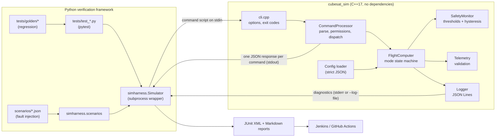
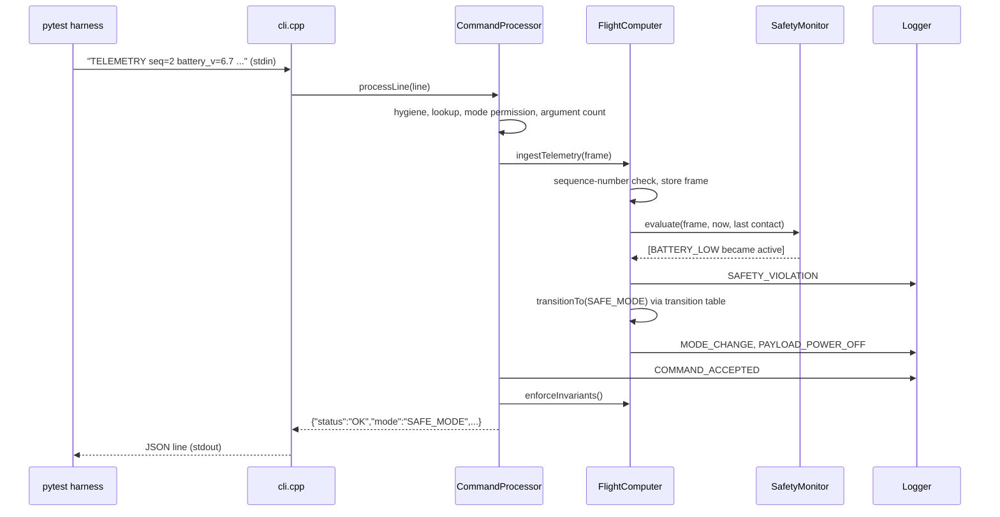

# Architecture

> Educational software-in-the-loop (SIL) simulator. Not flight software.

## 1. Big picture

The project has two halves that only talk through a process boundary:

1. **The system under test**: `cubesat_sim`, a C++17 command-line program that
   models a simplified flight computer.
2. **The verification framework**: Python + pytest code that starts the real
   binary, feeds it commands, and checks its outputs.

Keeping them separate means the tests verify the *compiled C++ program*, not
a Python re-implementation of it. That is the core idea of software-in-the-loop
testing: the real flight-software logic runs, but its sensors and ground
station are simulated.

## 2. C++ components

| File(s) | Responsibility | Why separate |
|---------|----------------|--------------|
| `include/cubesat/json.hpp`, `src/json.cpp` | Strict JSON parser/serializer (depth limit, duplicate-key rejection, deterministic output) | Lets the project build offline with zero third-party libraries |
| `include/cubesat/config.hpp`, `src/config.cpp` | Load and validate `config/simulation_config.json`: types, ranges, unknown/missing keys, contradictory thresholds | Bad configuration is rejected at start-up instead of producing silent wrong behaviour |
| `include/cubesat/telemetry.hpp`, `src/telemetry.cpp` | Parse and validate one telemetry frame; strict number parsing; plausibility limits | Input validation is separate from safety judgement |
| `include/cubesat/safety_monitor.hpp`, `src/safety_monitor.cpp` | Evaluate seven safety rules; report which became active or cleared | Detection is independent of response; threshold predicates are unit-testable |
| `include/cubesat/flight_computer.hpp`, `src/flight_computer.cpp` | Mode state machine, transition table, payload, counters, invariants, simulated clock | The single owner of the state |
| `include/cubesat/command_processor.hpp`, `src/command_processor.cpp` | Turn a text line into a structured JSON response; command table with per-mode permissions | Input handling stays out of the state machine |
| `include/cubesat/logger.hpp`, `src/logger.cpp` | Structured JSON-Lines diagnostics | Logs never mix with machine-readable responses |
| `include/cubesat/cli.hpp`, `src/cli.cpp`, `src/main.cpp` | Command-line options, file handling, exit codes | Testable with in-memory streams |
| `include/cubesat/result.hpp` | `Result<T>` success-or-error type | Expected failures are values, not exceptions |
| `unit_tests/unit_tests.cpp` | 21 C++ unit tests (tiny built-in runner, JUnit output) | Component-level checks without a test framework dependency |

Everything except `main.cpp` is compiled into the static library
`cubesat_core`, which is linked by both the CLI and the unit tests.

### Processing one command

## 3. How state persists across commands

A test that checks a multi-step behaviour (for example "violation, then
recovery refused, then recovery allowed") must send all steps to the **same
process**. `simharness.Simulator.run(commands)` writes the whole list to one
process's stdin. The flight computer keeps its state in memory until stdin
ends. Each `run()` call starts a new, independent process, so tests cannot
leak state into each other.

Time is **simulated**. It advances only through `TICK <seconds>`, so timeout
behaviour is deterministic and tests run in milliseconds.

## 4. Interfaces

* **Input:** one command per line (ASCII, configurable maximum length).
  Blank lines and `#` comments are ignored. The full command list is in
  [state-machine.md](state-machine.md#commands-and-permissions).
* **Output (stdout):** exactly one JSON object per command:
  `response_seq`, `command`, `status` (`OK`/`REJECTED`), `mode`,
  `sim_time_s`, plus `data` (OK) or `error.code`/`error.message` (REJECTED).
* **Diagnostics (stderr or `--log-file`):** JSON Lines with `log_seq`,
  `sim_time_s`, `severity`, `component`, `event`, `mode`, `message`, `details`.
* **Exit codes:** `0` ok, `2` usage, `3` configuration, `4` script/log file,
  `5` internal error. A *rejected command* is not a process failure. It is
  reported in-band and the session continues, as a real command handler
  would do.

## 5. Python framework

| Path | Purpose |
|------|---------|
| `simharness/build.py` | Find the binary (`CUBESAT_SIM_BIN`) or build it with CMake, so tests never use a stale binary by accident |
| `simharness/simulator.py` | `Simulator`/`SimRun`: run the binary (argument lists, no shell), parse and validate every output line, helpers such as `mode_changes()` and `events_after_command()` |
| `simharness/scenarios.py` | Data-driven fault-injection engine with precondition checks |
| `simharness/requirements.py` | Requirement catalogue loader (`tests/requirements.json`) |
| `tests/conftest.py` | Fixtures, requirement-ID validation, JUnit requirement properties |
| `tools/run_scenarios.py` | Runs scenarios and writes the fault-injection report |
| `tools/traceability_report.py` | Requirement-to-test matrix from JUnit XML |
| `tools/update_golden.py` | Regenerates golden regression files (only after an intentional change) |
| `tools/format_session.py` | Human-readable table of a session |

## 6. Design decisions

| Decision | Reason |
|----------|--------|
| In-house JSON parser instead of a third-party library | Zero dependencies, fully offline build, and strictness (duplicate keys, depth limit) suited to validating configuration |
| Line-based text commands, JSON responses | Easy to type by hand and to script, while still machine-checkable |
| Simulated clock (`TICK`) | Deterministic, fast timeout tests, with no flaky `sleep()` |
| Single transition table (`isTransitionAllowed`) | No scattered mode logic; illegal transitions are blocked centrally and logged |
| Safety detection separate from response | `SafetyMonitor` reports; `FlightComputer` decides. Each is testable alone |
| Hysteresis on value rules | A reading hovering at a limit cannot make the mode flap |
| Ground-commanded recovery (`EXIT_SAFE_MODE`) | Recovery is an explicit, logged decision; clearing a violation alone does not leave SAFE_MODE |
| Invariant check after every command | A logic defect (e.g. NOMINAL with active violations) is detected and contained in FAULT instead of being reported as healthy |
| Deterministic logs (sequence numbers, simulated time) | Golden-file regression testing and byte-identical reruns |
| Seeded-defect build option | Proves the tests detect a real bug, not just that they pass |
