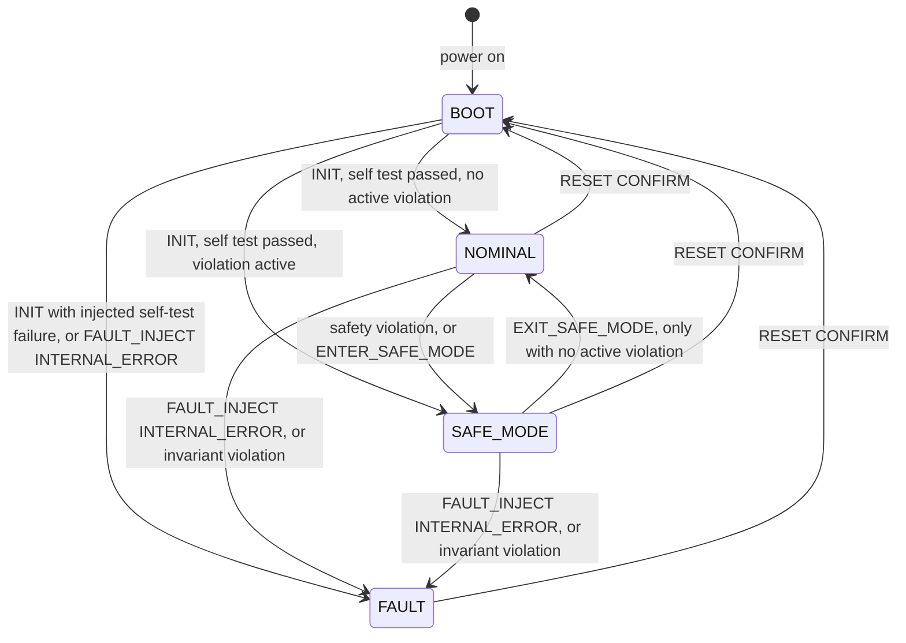

# Operating-Mode State Machine

This document is the **specification** that the tests check against. The
implementation is `FlightComputer::isTransitionAllowed()` and
`commandTable()` in the C++ sources. `tests/test_operating_modes.py` and
`tests/test_commands.py` hold an independent copy of these tables and fail if
the code and this document disagree.

## Modes

| Mode | Meaning | Payload | Safety rules evaluated |
|------|---------|---------|------------------------|
| `BOOT` | Powered on, waiting for `INIT` and the power-on self test | forced OFF | Only once, at `INIT` |
| `NOMINAL` | Normal simulated operation | may be ON | On every telemetry frame and `TICK` |
| `SAFE_MODE` | Restricted operation after a safety event or ground command | forced OFF | On every telemetry frame and `TICK` |
| `FAULT` | Unrecoverable simulated software error | forced OFF | Not evaluated (computer is not trusted) |

## Transitions



| From \ To | BOOT | NOMINAL | SAFE_MODE | FAULT |
|-----------|------|---------|-----------|-------|
| **BOOT** | - | `INIT` (pass) | `INIT` (pass, violation active) | `INIT` (self-test failure), `FAULT_INJECT INTERNAL_ERROR` |
| **NOMINAL** | `RESET CONFIRM` | - | safety violation, `ENTER_SAFE_MODE` | `FAULT_INJECT INTERNAL_ERROR`, invariant violation |
| **SAFE_MODE** | `RESET CONFIRM` | `EXIT_SAFE_MODE` (no violations) | - | `FAULT_INJECT INTERNAL_ERROR`, invariant violation |
| **FAULT** | `RESET CONFIRM` | **never** | **never** | - |

Rules that are deliberately *not* transitions:

* **No automatic recovery.** When a violation clears, `SAFETY_CLEARED` is
  logged but the computer stays in SAFE_MODE until the ground sends
  `EXIT_SAFE_MODE`. Recovery is always a commanded, logged decision.
* **Communication problems never cause FAULT.** A DOWN link only logs
  `COMM_LINK_DOWN`. Only when ground contact has been missing for longer
  than `comm_timeout_s` is `COMM_TIMEOUT` raised, which leads to SAFE_MODE
  (recoverable).
* **FAULT is sticky.** The only exit is `RESET CONFIRM`, which goes to BOOT.
  The computer must then pass `INIT` again with fresh telemetry.
* Every transition is logged as `MODE_CHANGE` with `from`, `to` and `reason`.
  An attempt at an undocumented transition is blocked, logged as
  `INVALID_TRANSITION_BLOCKED` and contained in FAULT.

### Invariants checked after every command

* The mode is never `NOMINAL` while any safety violation is active.
* The payload is never ON outside `NOMINAL`.

If an invariant is violated (which would be a software defect), the computer
logs `INVARIANT_VIOLATION` (CRITICAL) and enters FAULT.

## Commands and permissions

Order of checks for every line: input hygiene (`MALFORMED_INPUT`), command
lookup (`UNKNOWN_COMMAND`), mode permission (`NOT_PERMITTED_IN_MODE`),
argument checks (`INVALID_ARGUMENT`/`MISSING_FIELD`/`OUT_OF_RANGE`), then the
handler. Command names are case-insensitive. Arguments that are keywords
(`ON`, `CONFIRM`, ...) are also case-insensitive, while telemetry values
(`UP`, `VALID`, ...) are exact.

| Command | BOOT | NOMINAL | SAFE_MODE | FAULT | Notes |
|---------|:----:|:-------:|:---------:|:-----:|-------|
| `HELP` | yes | yes | yes | yes | Lists commands, usage, permitted modes |
| `STATUS` | yes | yes | yes | yes | Mode, violations, payload, counters |
| `GET_TELEMETRY` | yes | yes | yes | yes | Latest frame and its age |
| `TELEMETRY <fields>` | yes | yes | yes | no | Injects one simulated frame |
| `TICK <seconds>` | yes | yes | yes | yes | 1..`max_tick_s`; time passes in every mode |
| `INIT` | yes | no | no | no | Power-on self test |
| `ENTER_SAFE_MODE` | no | yes | yes (no-op) | no | Idempotent |
| `EXIT_SAFE_MODE` | no | no | yes | no | Refused with `ACTIVE_VIOLATIONS` if any rule is active |
| `PAYLOAD <ON\|OFF>` | no | yes | no | no | Simulated imaging payload power |
| `RESET CONFIRM` | no | yes | yes | yes | Reboot to BOOT; the only exit from FAULT |
| `FAULT_INJECT <type>` | yes | yes | yes | no | Test hook: `INTERNAL_ERROR`, or `SELF_TEST_FAILURE` (BOOT only) |

### Telemetry frame

```
TELEMETRY seq=<n> battery_v=<V> temp_c=<C> attitude_deg=<deg> comm=<UP|DOWN> sensors=<VALID|INVALID>
```

| Field | Unit | Accepted input (plausibility) | Notes |
|-------|------|-------------------------------|-------|
| `seq` | count | integer 0 .. 2^53-1 | Must be strictly greater than the last accepted `seq` (`STALE_SEQUENCE` otherwise). Reset clears the memory |
| `battery_v` | volt | 0 .. 20 | Simulated bus voltage |
| `temp_c` | °C | -150 .. 150 | Simulated board temperature |
| `attitude_deg` | degree | 0 .. 180 | Absolute pointing error |
| `comm` | - | `UP` / `DOWN` | Ground link status reported in the frame |
| `sensors` | - | `VALID` / `INVALID` | Sensor self-check flag |

All six fields are required exactly once; unknown fields are rejected.
Numbers must be plain decimals (`7`, `-3.5`, `1e2`). `nan`, `inf`, hex,
units (`7.4V`) and empty values are rejected. The plausibility ranges catch
*corrupt input*. The safety thresholds below judge *plausible but unsafe*
values.

## Safety rules

Thresholds come from `config/simulation_config.json`. **They are invented
demonstration values, not real spacecraft limits.**

| Rule | Trips when (strict) | Clears when (inclusive) | Default demo values |
|------|---------------------|-------------------------|---------------------|
| `BATTERY_LOW` | `battery_v < battery_min_v` | `battery_v >= battery_recover_v` | 6.8 V / 7.0 V |
| `TEMPERATURE_HIGH` | `temp_c > temp_max_c` | `temp_c <= temp_max_recover_c` | 60 °C / 55 °C |
| `TEMPERATURE_LOW` | `temp_c < temp_min_c` | `temp_c >= temp_min_recover_c` | -20 °C / -15 °C |
| `ATTITUDE_EXCEEDED` | `attitude_deg > attitude_max_deg` | `attitude_deg <= attitude_recover_deg` | 15° / 10° |
| `SENSOR_INVALID` | frame has `sensors=INVALID` | a frame with `sensors=VALID` arrives | - |
| `TELEMETRY_STALE` | `now - frame_time > telemetry_timeout_s` | a fresh frame arrives | 10 s |
| `COMM_TIMEOUT` | `now - last_contact > comm_timeout_s` | a frame with `comm=UP` arrives | 60 s |

Details that the tests pin down:

* A reading **exactly at** a trip limit is acceptable (6.8 V does not trip;
  6.79 V does).
* **Hysteresis:** between the trip and clear thresholds an active
  violation stays active (e.g. 6.9 V after a low-battery event).
* When `sensors=INVALID`, the numeric values in that frame are **not
  trusted**. They neither raise nor clear battery, temperature or attitude
  rules.
* `last_contact` is set at `INIT` and on every `comm=UP` frame.
* Multiple rules can be active at once. The SAFE_MODE reason is the first
  newly violated rule in the order listed above. Every active rule must clear
  before `EXIT_SAFE_MODE` is accepted.

## Response to each event

| Event | Logged as | Mode effect | Recovery path |
|-------|-----------|-------------|---------------|
| Value rule violated in NOMINAL | `SAFETY_VIOLATION` (WARNING) | NOMINAL → SAFE_MODE, payload OFF | Value reaches clear threshold, then `EXIT_SAFE_MODE` |
| Sensors INVALID | `SAFETY_VIOLATION` | → SAFE_MODE | Valid frame, then `EXIT_SAFE_MODE` |
| Telemetry stale | `SAFETY_VIOLATION` | → SAFE_MODE | Fresh frame, then `EXIT_SAFE_MODE` |
| Link DOWN (short) | `COMM_LINK_DOWN` (WARNING) | none | `COMM_LINK_RESTORED` on UP frame |
| Link DOWN > comm_timeout_s | `SAFETY_VIOLATION` (COMM_TIMEOUT) | → SAFE_MODE (never FAULT) | UP frame, then `EXIT_SAFE_MODE` |
| Corrupt/implausible frame | `TELEMETRY_REJECTED` | none (frame discarded) | n/a |
| Unknown/invalid command | `COMMAND_REJECTED` | none | n/a |
| Injected internal error | `FAULT_INJECTED`, `MODE_CHANGE` (CRITICAL) | → FAULT | `RESET CONFIRM` → BOOT → `INIT` |
| Self-test failure | `SELF_TEST_FAILED` (ERROR) | BOOT → FAULT | `RESET CONFIRM` → BOOT → `INIT` |

## What `RESET CONFIRM` clears

Cleared: latest telemetry, sequence-number memory, link state, active
violations, payload, armed injected faults, fault reason.
Kept: simulated clock and lifetime counters (`resets`, `faults`,
`safe_mode_entries`, ...), so the session history remains readable.
